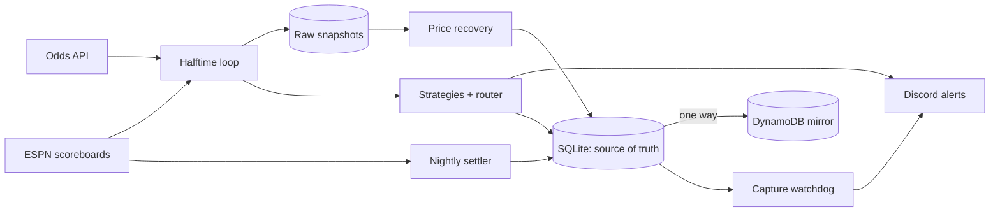

# HalftimeEdge (showcase)

A live sports-betting research system I built and run locally: it watches games, captures halftime
lines and scores, evaluates statistical strategies, posts alerts, and **settles and audits every bet
it places**. This repo is a curated excerpt. The strategy logic, thresholds and data are private on
purpose; what is here is the engineering that keeps the numbers honest.

## What the system does

| Stage | What happens |
|---|---|
| Ingest | Odds API + ESPN scoreboards polled on a loop; raw odds snapshots stored verbatim |
| Evaluate | Per-sport strategy registry; a router resolves conflicting signals per market |
| Alert | Discord cards with a production/beta tier and the strategy's own settled record |
| Settle | Date-correct nightly settler grades bets against final scores |
| Audit | Watchdogs and integrity audits check that capture, settlement and pricing are working |

Single source of truth is SQLite; a DynamoDB mirror feeds a website and is never authoritative.

## Architecture



More detail in [docs/architecture.md](docs/architecture.md).

## What's in this repo

| File | Why it exists |
|---|---|
| `tools/settle_stale_bets.py` | Grades bets by *their own game date*, not today's date. The loop runs past midnight and matchup keys repeat in a series, so naive settlement mis-grades. |
| `tools/capture_watchdog.py` | Nightly check: if a sport played N games but we captured almost no halftimes, alert. Built after an upstream API change silently blinded capture for a week with zero errors. |
| `tools/backfill_bet_prices.py` | Recovers the real price of each bet from stored raw odds so units are computed at the odds actually available, not an assumed -110. |
| `tools/track_external_picks.py` | Records a third-party picks service forward in time, stores every raw response, and grades each pick independently against ESPN finals. A claimed edge is only believed after a record exists. |

## Lessons the audits produced

These are the findings I'm proudest of, because each one made a number *worse* and the system more honest.

1. **Units must use the odds you got.** A strategy showing +25.35u was −1.48u at recorded prices:
   a flat per-win payout had inflated every record. Win rate alone is not an edge; compare it to the
   breakeven implied by the price.
2. **Stated probabilities were anti-calibrated.** Bets claiming ~84% won ~50%. Only the narrow band
   near 52–56% was honest. The headline confidence shown to users now comes from settled results.
3. **A high model score was label poisoning.** An AUC of 0.715 fell to 0.573 once a mislabelled line
   field was fixed. Lesson: never revert a model because a data fix lowered its score.
4. **Silent-200 traps.** Several upstream APIs return HTTP 200 with truncated or empty data
   (a query parameter that caps results to 25, a removed date-range endpoint). Counting skips by
   status and adding capture watchdogs turned silent failures into alerts.
5. **Observation rows counted as bets; wash trades counted as volume.** Shadow rows and
   self-cancelling pairs were inflating the book until each was filtered and guarded at write time.
6. **Test the pipeline before judging the signal.** For the external picks tracker, the first live
   response broke the parser (a different name format than the fixtures). Raw responses are stored
   so rows can be re-parsed instead of lost.

## Design principles

- **Strict-None**: a missing number is skipped and logged, never replaced with `0`. A fabricated default once became the system's most confident bet.
- **Temporal isolation**: pregame data never decides a halftime bet's outcome.
- **One-way reconciliation**: SQLite → DynamoDB only.
- **Report outcomes faithfully**: failing tests and losing strategies are recorded, not hidden.

## Running the tools

Standard library plus `requests`; configuration is via environment variables (no secrets in the repo).

```
python tools/track_external_picks.py --selftest
python tools/capture_watchdog.py --help
```

The full system is available to walk through in a screen-share.
