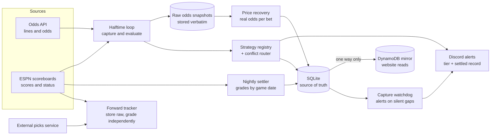

# Architecture

## Reading the diagram

| Component | Guarantee it provides |
|---|---|
| Raw odds snapshots | Any parsing mistake can be corrected later by re-reading the original response |
| SQLite → DynamoDB | One direction only; the mirror can never overwrite the record |
| Nightly settler | A bet is graded against its own game date, not the date the job runs |
| Price recovery | Units reflect the odds actually available, not an assumed price |
| Capture watchdog | A quiet failure (HTTP 200 with empty data) becomes an alert |
| Forward tracker | A third party's claims are graded by us on games that hadn't happened when recorded |
